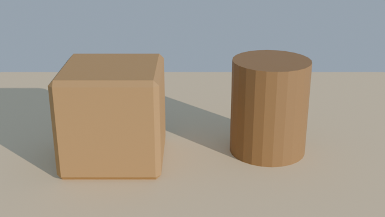

# 13 · 能不能让 AI 直接连上 Unity 和 Blender（2026-10-29 21:46 实测和调研）

> 对话原文第 10 轮。用户问："我们可以连接 unity 和 blender 的 api 吗"。
> 结论：**Blender 已经在沙盒里跑通了；Unity 要看你在哪台电脑上用 AI。**

## 一、Blender：已实测，能用

**结果：** 在 Kiro Web 的沙盒里装上了 Blender 5.0.1（无界面的 Python 版），AI 用脚本建了一个小场景（地面、木箱、木桶、暖色阳光、斜后方的镜头），导出成网页游戏能用的 GLB 文件，再用 CPU 渲染出一张预览图。建场景和导出用了 0.1 秒，渲染一张 640×360 的图用了 2.5 秒。

**这意味着：**
- 不需要你装 Blender，也不需要 MCP。AI 直接写 Python 脚本操作 Blender，能做的事和 MCP 差不多。
- AI 能做：用 Blender 整理 Tripo 生成的模型（缩放、对齐、减面、合并）；直接用代码建简单的道具（木板、箱子、木筏）；导出 GLB 给网页用，或导出 FBX 给 Unity 用；渲染预览图，AI 自己看图检查效果。
- 网页路线和 Unity 路线都能配合 Blender 用。

**限制：**
- 沙盒没有显卡，只能用 CPU 渲染（Cycles）。预览图很快，高画质的大图会慢。Blender 里依赖显卡的实时渲染（EEVEE）用不了。
- 角色的骨骼和动作，能用脚本做，但很费时间。人形角色绑骨还是优先用 Tripo 自带的自动绑骨。

**怎么装（以后新的会话要重装一次，约 35 秒，占 1.2 GB）：**
- 运行 `bash tools/blender/setup.sh`，装到工作区里的 `.tools` 文件夹（在 git 仓库外面，不会被提交）。
- 之后用 `.tools/blender-py 脚本.py` 运行 Blender 脚本。冒烟测试：`.tools/blender-py tools/blender/smoke_test.py 输出文件夹`。
- 这是准备工具，不是游戏代码。比赛规则允许提前准备工具。

**装的过程中踩的坑（已经写进脚本）：**
- Blender 官网的下载地址会拦截脚本下载，所以改用 PyPI 上的官方 Python 版（`pip install bpy`）。
- 沙盒的系统盘是只读的，不能用系统命令装缺的库（libSM、libICE、libGL）。办法是把这几个库的安装包下载下来，解压到自己的文件夹里再指定路径。
- `/tmp` 在会话中途会被清空，`/projects` 下除了工作区大多也写不进去，所以东西都放在工作区里。

**另外：** Blender 官方在 2026 年 4 月发布了自己的 MCP 服务器，社区也有一个很流行的 Blender MCP。它们都要在电脑上打开 Blender 的界面才能用（官方版要求 Blender 5.1 以上）。我们在沙盒里直接用脚本，用不到它们。来源：[Blender Lab MCP Server](https://www.blender.org/lab/mcp-server/)、[社区版 blender-mcp](https://github.com/ahujasid/blender-mcp)。

## 二、Unity：要看 AI 在哪台电脑上

**关键限制：** 我们现在用的 Kiro Web 跑在云端的沙盒里，**连不到你自己的电脑**。Kiro 文档原话的意思是：沙盒在云端隔离，访问不到你本机。就算从你电脑上的 Kiro 打开这个云端会话，命令和工具也还是在云端执行。来源：[Running Kiro in the cloud](https://kiro.dev/docs/guides/running-kiro-in-the-cloud)、[Cloud sessions](https://kiro.dev/docs/cloud-sessions)。

Unity 编辑器要装在你的电脑上，所以有三种用法：

**方式 1：AI 在云端写代码，你在电脑上运行（现在就能用）**
- AI 写 C# 代码和场景改动，推到 GitHub；你在电脑上拉下来，在 Unity 里点运行，把看到的情况和报错截图发给 AI。
- 好处：不用另外装 AI 工具，对话和记录都在这里。
- 代价：每一轮都要你来回操作，AI 看不到编辑器里的实际效果。

**方式 2：在你的电脑上用 Kiro，让 AI 直接操作 Unity（能做到"直接连上"）**
- 在你电脑上装 Kiro IDE 或 Kiro CLI，开一个本地会话（不是现在这个云端会话）。Kiro 的本地版支持连接你电脑上的工具（MCP），文档里也写了支持连本机地址。来源：[Kiro MCP 配置](https://kiro.dev/docs/mcp/configuration)。
- Unity 官方现在的做法：Unity 6 以上，用 Unity 的命令行工具（Unity CLI）从外部操作正在运行的编辑器：创建和修改物体、改场景和资源、看层级、运行 C#，还能装编辑器、处理许可证、打包和看日志。Unity 原来的官方 MCP 服务器在 AI Assistant 2.21 版里已经标为弃用，改推 Unity CLI。Unity 给 Claude Code、Codex、Grok 出了官方插件；Kiro 不在名单里，但 Kiro 本地版能执行命令行，理论上能用 Unity CLI，**没有实测**。来源：[Unity AI 功能页](https://unity.com/features/ai)、[Unity 的 Claude Code 插件](https://unity.com/blog/unity-plugin-for-claude-code)、[Unity MCP 文档（已弃用说明）](https://docs.unity3d.com/Packages/com.unity.ai.assistant@2.21/manual/integration/unity-mcp-get-started.html)。
- 好处：AI 能自己在编辑器里搭场景、看报错、试运行，不用你转述。
- 代价：你要在电脑上装 Unity Hub、Unity 6 编辑器（好几 GB）、Kiro IDE 或 CLI、git，并在电脑上登录 GitHub。电脑配置要够。对话原文和文档还是能照样存进仓库，但要在本地会话里继续这个做法。
- 还要测：Kiro 本地版 + Unity CLI 能不能配合顺畅。

**方式 3：把 Unity 装进云端沙盒，不开界面，只用命令行打包（没测）**
- Unity 有 Linux 版，可以不开界面地打包成网页版。理论上你就不用装任何东西。
- 但要下载好几 GB，要在沙盒里登录你的 Unity 账号激活许可证，沙盒也没有显卡，AI 看不到编辑器画面。**风险最大，没测试过。**

## 三、对鲁滨逊这个游戏意味着什么
- **Blender 现在就能加进来**，不管最后选网页还是 Unity：整理 Tripo 模型、补简单道具、AI 自己渲染检查。
- **想用 Unity 并让 AI 直接操作**，基本只能走方式 2，在你电脑上用 Kiro。要先知道你的电脑配置，并在比赛前试一次。
- 选网页路线的话，Unity 这部分都不用管。

## 四、用户的回答（第 11 轮，10-29 22:59）
- **不愿意在电脑上装软件。** 所以方式 1 和方式 2 都不用了（两者都要在用户电脑上装 Unity）。Unity 只剩方式 3（装进云端沙盒），没测过，风险大。
- **Blender 让 AI 试试。** 试验结果见 `docs/14-Blender试验.md`。
