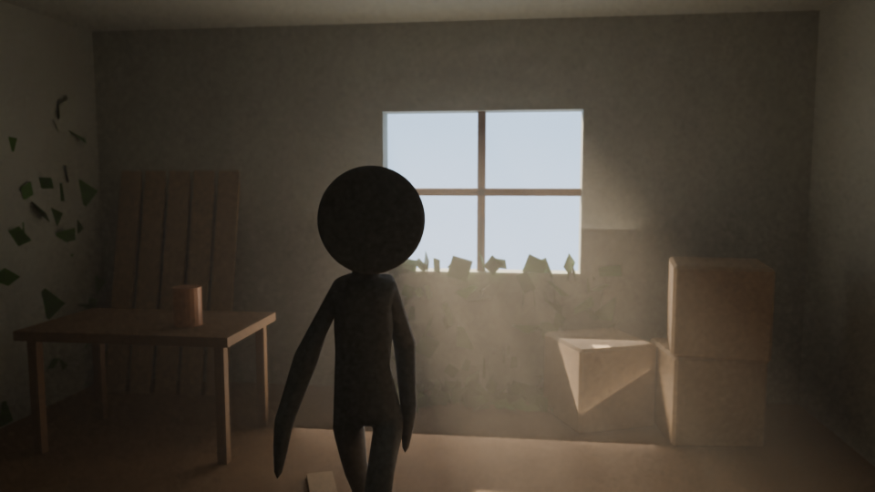
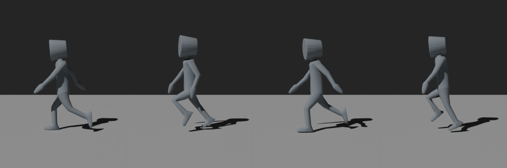

# 14 · Blender 试验（2026-10-29 22:59 到 23:04）

> 对话原文第 11 轮。用户说："不愿意在电脑装，blender 你试试"。
> 试验用的东西都和比赛作品无关：一间废弃的屋子、一个公开的示例人物。目的是看清 Blender 在这个项目里能帮上什么、做不到什么。

## 试了什么
1. **整理一个外部的人物模型**，模拟以后整理 Tripo 模型的过程。
2. **用代码搭一个有氛围的场景**，看能不能做出参考图那种"阳光从窗户照进废弃屋子"的感觉，镜头放在人物身后。
3. **检查人物的骨骼动画**，看整理之后走路动作还在不在。

示例人物是 Khronos 公开的 glTF 示例模型 Cesium Man（作者 Cesium，[CC BY 4.0](https://creativecommons.org/licenses/by/4.0/)，[来源](https://github.com/KhronosGroup/glTF-Sample-Assets/tree/main/Models/CesiumMan)）。它原来的贴图上有 Cesium 公司的标志，许可证不允许在别处使用这个标志，所以渲染时换成了纯色。模型文件本身没有放进仓库。

## 结果

### 1. 整理人物模型：成功
| | 整理前 | 整理后 |
|---|---|---|
| 身高 | 1.458 米 | 1.750 米（按设定缩放） |
| 脚底位置 | 不在地面 | 正好在地面（z = 0），并居中到原点 |
| 面数 | 4672 | 2336（减了一半） |
| 骨骼 | 19 根 | 19 根 |
| 动画 | 1 段，0 到 48 帧 | 导出再导入后仍是 1 段，0 到 48 帧 |

这正是 Tripo 模型放进游戏前要做的事：统一大小、站到地上、控制面数，并且确认骨骼和动作没丢。

踩到一个坑：Blender 导入 glTF 时会额外生成显示骨骼用的辅助物体，第一次量尺寸时把它们也算进去了，量出来不对。已在脚本里排除。

### 2. 有氛围的场景：做得出光影，做不出细节

- **做得出的：** 低角度的暖色阳光从窗户照进来，空气里有灰尘，能看到光柱；镜头在人物斜后方，背景稍微虚化；整体是电影感的暗调。
- **做不出的：** 桌子、箱子、木板都是用方块拼的，一看就是简单形状；墙角的"植物"其实是一堆小绿片，像碎纸，不像叶子。精细的物件和植物要靠 Tripo 生成，代码拼不出来。
- **速度：** 960×540 一张图在 CPU 上渲染约 43 秒。

### 3. 走路动画：正常

第 0、12、24、36 帧四个姿势各不相同，腿和手臂交替摆动，说明骨骼动画在整理后还能用。四帧一共渲染了约 3 秒。

## 重要：Blender 渲染的图不等于游戏里的画面
- 上面的图是 Blender 花 40 多秒慢慢"算"出来的。游戏里每秒要画 30 到 60 张，在手机浏览器里根本没法这样算。
- 所以游戏画面要在网页里重新做灯光。光柱、灰尘这类效果在网页里要用近似的办法（比如半透明的光锥、雾），效果会比上图弱一些。
- 有一个办法能把 Blender 的光影带进网页：把固定场景的光照提前"烘焙"成贴图，网页只负责显示，手机也能跑。只适合不动的场景（墙、地、大石头），会动的人物和物体还是要实时打光。**这个还没试。**

## 结论：Blender 在这个项目里的用法
- 整理 Tripo 生成的模型：缩放、落地、减面、检查骨骼和动作。已验证。
- 用代码做简单的形状：木板、箱子、栅栏这类。精细物件和植物交给 Tripo。
- 渲染预览图，AI 自己看图检查。已验证。
- 可能的加分项：把固定场景的光照烘焙成贴图，给网页用。没试。
- 不适合：直接当游戏画面用。

## 文件
- `tools/blender/trial/process_model.py`：整理模型（缩放、落地、减面、导出、再导入检查）。
- `tools/blender/trial/mood_scene.py`：搭屋子场景并渲染，再渲染走路的四帧。
- `tools/blender/trial/make_sheet.py`：把四帧拼成一张图。
- 运行前先用 `tools/blender/setup.sh` 装好 Blender（见 docs/13）。
