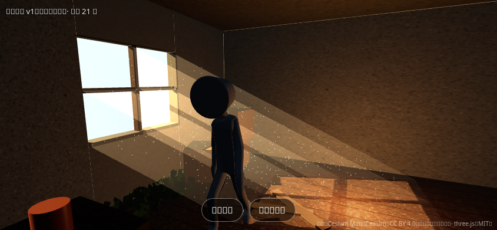
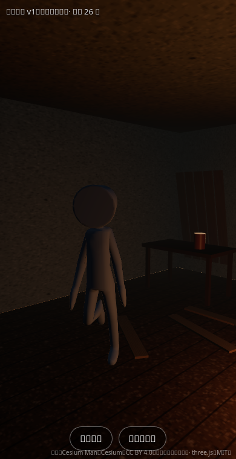

# 15 · 网页画面试验 v1（2026-10-29 23:30 到 23:42）

> 对话原文第 12 轮。用户说："给我临时链接看看"。
> 把 docs/14 里 Blender 试验的同一个场景（废弃屋子、窗外阳光、灰尘光柱、人物走路、越肩镜头）做成网页，给用户一个能在手机上打开的链接，看网页里实际能做到什么画面、卡不卡。**和比赛作品无关**，比赛时代码从零写。

## 链接
- 临时链接（固定在这个版本）：https://raw.githack.com/historycrew5423-art/3d-/5412843119dd306d21b936339a016a49d84c2a96/demo/index.html
- 打开后先出现一个英文的中转提示页（带广告），点 **Open the page** 才进入。这是 raw.githack 这个第三方服务的规定。
- 代码在 `demo/`，说明和素材来源见 `demo/README.md`。

## 页面里有什么
- 用 three.js 实时画的废弃屋子：墙、地板、桌子、箱子、木板、窗台下的叶子。材质的斑驳纹理是代码现画的，没有图片文件。
- 窗外的阳光会投下窗框形状的影子；四道半透明的光柱和 500 颗飘动的灰尘，是近似做法，不是真的体积光。
- 人物沿椭圆路线一直走，走路动作来自模型自带的动画；镜头跟在斜后方。
- 左上角显示版本号和每秒帧数。底部两个按钮：**画质**（高：阴影清晰、有灰尘、按手机屏幕清晰度画；低：阴影粗、没有灰尘、只画 1 倍清晰度）和 **镜头**（跟随 / 固定）。
- 手机竖着拿时，镜头自动拉远、视角加宽。

## 沙盒里的检查结果
用沙盒自带的无界面浏览器打开临时链接并截图（沙盒没有显卡，靠 CPU 模拟画图）：
- 页面能正常加载，没有报错，人物在走。
- 帧数每秒 21 到 26 帧。手机有显卡，应该更高，要用户实测。
- 截图里的中文显示成方块，是因为沙盒的浏览器没装中文字体，手机上不会这样。

横屏：

竖屏（这一刻人物背对窗户，所以偏暗）：

**和 Blender 渲染图（docs/14）比：** 网页版的光柱和灰尘是假的，但横屏时阳光、窗影、光柱、灰尘一起出现，氛围接近；暗处更黑、更糙。人物是没有贴图的测试人偶，道具是方块，这两样以后靠 Tripo 模型换掉。

## 过程中遇到的问题
- **GitHub Pages 开不了：** AI 用 API 打开 Pages 被拒绝（HTTP 403），Kiro Agent 这个 GitHub App 没有 Pages 权限（仓库的管理员权限本身是有的）。要用户在 GitHub 网页上手动开一次。
- **所以先用 raw.githack 当临时链接：** 它把 GitHub 上的文件转成能直接打开的网页。缺点：第三方服务，不保证速度和可用性；有英文中转页；第一次请求大文件可能超时（实测第一次 three.js 主文件超时，第二次 0.2 秒）。
- **.glb 文件会被 raw.githack 转到 raw.githubusercontent.com**，国内常打不开。办法：把人物模型转成 base64 文本放进一个 JS 文件里（`demo/assets/character-glb.js`），页面只加载 HTML 和 JS。
- **three.js 放在仓库里**（`demo/vendor/`，r186，MIT 许可），不用国外 CDN，免得国内加载不了。未压缩约 2.2 MB，传输时会被压缩。
- 新版 three.js 去掉了柔和阴影的一种类型（PCFSoftShadowMap），换成 PCFShadowMap。

## 换成稳定链接：开 GitHub Pages（要用户操作）
1. 打开 https://github.com/historycrew5423-art/3d-/settings/pages
2. "Build and deployment"（构建和部署）下，Source 选 **Deploy from a branch**。
3. Branch 选 **handoff-pack**，文件夹选 **/ (root)**，点 **Save**。
4. 等一两分钟，页面顶部会出现网址。试验页面在 https://historycrew5423-art.github.io/3d-/demo/
- 好处：没有中转页，以后 AI 每次推送，网址一两分钟后自动更新。比赛时也要用同样的办法发布，现在开一次正好演练。
- 仓库已经有 `.nojekyll` 文件，GitHub 会原样发布文件，不做额外处理。

## 要用户反馈的
1. 链接能不能打开，加载多久。
2. 左上角每秒多少帧，高画质和低画质各看一下。
3. 画面感觉和参考图比怎么样。
4. 手机型号。
